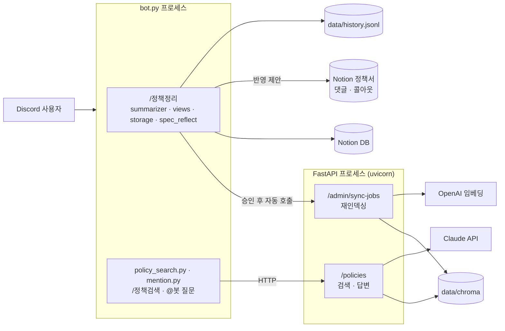

# policy-bot

Discord 스레드에서 흩어진 정책 결정을 정리해 Notion에 쌓고, 쌓인 결정과 기능명세서(정책서)를 RAG로 검색하고 질문하는 디스코드 봇.

- `/정책정리` — 스레드 논의를 Claude가 정책 결정으로 요약 → 요청자가 승인 화면에서 결정별로 수정·제외 → Notion DB + 로컬 JSON 저장.
  승인하면 정책서에 **반영 제안**(댓글·색 콜아웃)도 남긴다. 정책서 원문은 고치지 않고 반영은 PM이 한다.
  같은 스레드를 다시 정리하면 바뀐 결정만 이전 기록을 덮어쓰고, 이전 버전은 페이지 본문의 '변경 이력'에 남는다.
- `/정책검색` — 저장된 결정을 의미 기반으로 검색 (LLM 호출 없음)
- `@봇 질문` — 봇을 태그하고 자연어로 질문하면 검색된 결정만 근거로 Claude가 답변 (최신 결론 · 히스토리 · 충돌 · 확인 필요 + 출처).
  스레드 최근 메시지와 답장한 이전 Q/A를 맥락으로 써서 "이거 정책이랑 맞아?", "그럼 비회원은?" 같은 질문도 받는다. 봇 답변에 답장하면 대화가 이어진다.
  (예전 `/정책질문` 명령어를 대체)

방향과 설계 결정은 [`docs/DIRECTION.md`](docs/DIRECTION.md), 작업 목록과 진행 상태는 [`docs/EXPERIMENTS.md`](docs/EXPERIMENTS.md), 배포는 [`docs/DEPLOY.md`](docs/DEPLOY.md)에 있다.

## 구조



봇과 API는 별도 프로세스이고 HTTP로만 통신한다. 봇은 RAG 로직을 갖지 않고, 검색 인덱스는 API 서버 프로세스만 갱신한다.

### RAG 흐름

| 단계 | 파일 | 하는 일 |
|---|---|---|
| 로드 | `app/rag/notion_loader.py` | Notion DB(또는 `history.jsonl`)의 결정을 텍스트 + 메타데이터로 변환 |
| 로드 (정책서) | `app/rag/spec_index.py` | `NOTION_SPEC_PAGES`의 기능명세서를 정책 ID(표 한 행) 단위 문서로. 링크는 그 행으로 바로 감 |
| 청킹 | `app/rag/chunker.py` | 800자 단위로 자르고 조각마다 `[정책] 주제 \| 영역 \| 상태`(정책서는 `[정책서] ID 이름 \| 화면 \| 버전`) 헤더 부착 |
| 임베딩 | `app/rag/embedder.py` | OpenAI 또는 로컬(e5) 모델로 벡터화 |
| 저장 | `app/rag/store.py` | Chroma(`data/chroma`)에 저장. 청크 내용 해시가 바뀐 문서만 재처리 |
| 검색 | `app/rag/retriever.py` | 유사도 검색(선택: + BM25 키워드 하이브리드 `keyword.py`) + 영역/상태 필터 + 점수 하한선 + 문서당 1개 + 재논의 짝 붙이기 |
| 리랭킹 | `app/rag/reranker.py` | (선택) 후보를 작은 모델이 질문과 함께 읽고 다시 채점, 관련 없으면 거절 |
| 생성 | `app/rag/generator.py` | 검색 결과를 `<context>`로 붙여(정책서/결정기록 구분, 재논의 관계 표시) Claude가 근거 기반 답변 |

## 폴더 구성

```
├── bot.py               # 디스코드 봇 진입점, /정책정리
├── thread_reader.py     # 스레드 메시지 읽기 (동의 리액션 표시 포함)
├── summarizer.py        # 스레드 → 정책 결정 요약 (Claude), 재정리 시 new/update/unchanged 판정
├── prompts.py           # 요약·정책서 매칭 프롬프트 / 출력 스키마
├── views.py             # 승인 화면(결정별 수정·제외·연결 해제), 승인 후 재인덱싱·정책서 반영 호출
├── storage.py           # 로컬 JSON(append-only 버전) + Notion 저장
├── notion_store.py      # Notion DB 스키마, 저장·갱신, 변경 이력 본문
├── spec_reflect.py      # 승인된 결정 → 정책서 매칭 → 댓글·콜아웃·미분류 페이지 반영 제안
├── setup_notion.py      # Notion DB 최초 생성 / 이미 있으면 새 속성만 추가
├── policy_search.py     # /정책검색 → API 호출, API 호출·메시지 분할 공용
├── mention.py           # @봇 멘션 질문 → 맥락 수집 → /policies/answers
├── config.py            # 봇 설정 (기능영역, 상태 목록, 정책서 페이지)
├── app/
│   ├── config.py        # RAG/API 설정 (.env 공유)
│   ├── usage.py         # 토큰·비용·지연 기록 (data/usage.jsonl)
│   ├── limits.py        # 사용자별 일일 한도, 월 예산 알림·차단
│   ├── evaluation.py    # 골든셋 평가 로직
│   ├── api/             # FastAPI: main, routers(policies · sync · usage), schemas, deps
│   └── rag/             # 로더(결정·정책서), 청킹, 임베딩, 저장소, 키워드, 검색, 리랭킹, 생성
├── scripts/             # ingest · eval_rag · batch_summarize · 정책서 확인/반영 도구 (아래 각 절)
├── eval/                # 골든셋 형식 설명과 예시 (실제 골든셋·결과는 git 제외)
├── docs/                # DIRECTION · EXPERIMENTS · DEPLOY · CLONE_GUIDE
└── tests/               # API 키 없이 도는 테스트
```

## 시작하기

### 1. 디스코드 봇 만들기
1. https://discord.com/developers/applications → New Application
2. **Bot** 탭 → Reset Token → 토큰 복사
3. **Bot** 탭 → Privileged Gateway Intents → **Message Content Intent 켜기**
4. **OAuth2 → URL Generator**
   - Scopes: `bot`, `applications.commands`
   - Bot Permissions: View Channels, Read Message History, Send Messages, Send Messages in Threads, Embed Links
5. 생성된 URL로 테스트 서버에 초대
6. 디스코드 설정 → 고급 → 개발자 모드 → 서버 우클릭 → ID 복사 → `GUILD_ID`

### 2. Notion 연결 (선택)
1. https://app.notion.com/developers/connections 에서 connection 생성 → 토큰 복사
2. DB를 넣을 페이지 ··· → Add connections → 만든 connection 추가
3. `.env`에 `NOTION_TOKEN`, `NOTION_PARENT_PAGE_ID` 입력 후 `python setup_notion.py`

Notion을 설정하지 않으면 결정은 `data/history.jsonl`에만 저장되고, RAG도 이 파일을 읽는다.

### 3. 설치와 설정
```bash
python -m venv .venv && source .venv/bin/activate
pip install -r requirements.txt
cp .env.example .env
```

| 키 | 필수 | 설명 |
|---|---|---|
| `DISCORD_TOKEN` | ✅ | 봇 토큰 |
| `ANTHROPIC_API_KEY` | ✅ | 요약, 멘션 질문 답변 |
| `GUILD_ID` | 권장 | 지정하면 해당 서버에 커맨드 즉시 등록 |
| `CLAUDE_MODEL` | | 기본 `claude-sonnet-5-5` |
| `NOTION_TOKEN`, `NOTION_DATA_SOURCE_ID` | | Notion 저장/조회. `setup_notion.py`가 ID를 채움 |
| `EMBEDDING_BACKEND` | | `openai`(기본) 또는 `local` |
| `OPENAI_API_KEY` | openai일 때 | 임베딩용 |
| `RAG_SOURCE` | | `auto`(Notion 있으면 Notion) / `notion` / `jsonl` |
| `RAG_MIN_SCORE` | | 검색 점수 하한선, 기본 `0.3` |
| `ADMIN_TOKEN` | ✅ | `/admin/sync-jobs` 인증. 임의의 긴 문자열 |
| `POLICY_API_URL` | | 봇이 부를 API 주소, 기본 `http://localhost:8000` (Docker에서는 `http://api:8000`) |
| `API_KEY` | 외부 공개 시 | `/policies/*` 인증 키 |
| `RERANK_ENABLED` | | LLM 리랭킹 사용 (`RERANK_MODEL` 기본 `claude-haiku-5-5`) |
| `HYBRID_ENABLED` | | 벡터 + BM25 하이브리드 검색 (기본 꺼짐) |
| `NOTION_SPEC_PAGES` | | 기능영역별 정책서 페이지. 반영 제안과 검색 인덱스에 같이 쓴다 (`SPEC_INDEX_ENABLED=false`로 인덱싱만 끔) |
| `SUMMARY_MAX_TOKENS` | | 요약 응답 최대 토큰, 기본 8192 |
| `NOTION_PM_USER_IDS`, `NOTION_SPEC_INBOX_PAGE`, `SPEC_REFLECT_STATUSES`, `SPEC_MATCH_MODEL` | | 정책서 반영 제안 설정 (아래 '정책서 반영 제안' 절) |
| `DAILY_ANSWER_LIMIT` | | 사용자별 하루 멘션 답변 횟수, 기본 30 (0 = 제한 없음) |
| `MONTHLY_BUDGET_USD`, `BUDGET_ALERT_RATIO`, `BUDGET_HARD_STOP`, `BUDGET_ALERT_WEBHOOK_URL` | | 월 예산, 알림 비율(기본 0.8), 초과 시 차단 여부, 알림 웹훅 |

로컬 임베딩을 쓰려면 `pip install sentence-transformers` 후 `EMBEDDING_BACKEND=local`. 백엔드를 바꾸면 `python -m scripts.ingest --force`로 전체 재인덱싱한다.

### 4. 실행 (터미널 2개)
```bash
# 터미널 A — API 서버 (http://localhost:8000/docs)
uvicorn app.api.main:app --reload

# 터미널 B — 봇
python bot.py
```
로그에 `길드 ...에 커맨드 2개 등록`(`/정책정리`, `/정책검색`)이 뜨면 준비 완료.

처음 한 번은 인덱스를 만들어야 한다. API 서버가 떠 있는 상태에서:
```bash
curl -X POST localhost:8000/admin/sync-jobs \
  -H "X-Admin-Token: $(grep ^ADMIN_TOKEN .env | cut -d= -f2)" \
  -H "Content-Type: application/json" -d '{}'
```
이후 `/정책정리`로 승인한 결정은 자동으로 인덱스에 반영된다.

## 정리 흐름 (`/정책정리`)
1. 스레드를 읽는다 (동의 리액션 👍 ✅는 `[동의 리액션: 이름]`으로 대화록에 표시).
2. Claude가 결정 단위로 요약한다. 상태(제안 · 논의중 · 최종결정)는 말한 사람의 직책이 아니라 대화의 확정 신호로 판단한다.
   **결정일**은 근거 메시지 중 가장 늦은 시각, **정리일**은 승인 시각으로 따로 저장한다.
3. 승인 화면에서 결정별로 [수정](주제·상태·결정·근거·적용범위) · [제외]를 할 수 있다. 고친 필드는 `edited_fields`에 남는다.
4. 승인하면 Notion DB와 `data/`에 저장하고, 검색 인덱스를 갱신하고, 정책서에 반영 제안을 남긴다.

**재정리**: 같은 스레드를 다시 정리하면 결정마다 `new` / `update` / `unchanged`를 판정한다. 정리 이후 새 메시지가 없으면 LLM을 부르지 않는다.
`update`는 이전 기록을 덮어쓰고 이전 버전을 '변경 이력'에 남긴다. 이전이 최종결정인데 이번이 논의중이면 덮지 않고 새 기록으로 저장하고 "재논의 대상"으로 연결한다 (답변: "현재 A, B로 변경 논의 중").
잘못 연결됐으면 승인 화면의 [연결 해제]로 새 기록으로 저장한다. 설계 이유는 `docs/DIRECTION.md` 2-1.

## 정책서 반영 제안
승인된 결정(기본: 최종결정만)을 `NOTION_SPEC_PAGES`의 정책서와 매칭해, **원문은 건드리지 않고 제안만** 남긴다. 반영은 PM이 한다.

| 판정 | 동작 |
|---|---|
| `modify` (기존 정책 ID와 다름) | 해당 표 행에 댓글 (+ PM 멘션) |
| `new` (화면은 있는데 ID 없음) | 그 화면 기능 표 뒤에 노란 콜아웃 |
| `unknown` (위치 모름) | 정책서 페이지 댓글 |
| `same` · `skip` | 이미 반영됨 / 정책서 대상 아님(디자인 리소스·구현 방식 등) → 아무것도 안 함 |
| 정책서 없음 | `NOTION_SPEC_INBOX_PAGE`(미분류 제안 페이지)에 체크박스 |

- 노션 통합에 **댓글 읽기·삽입 권한**(Capabilities → Comment)이 필요하다.
- 같은 기록·같은 버전은 다시 달지 않고, 바뀐 기록(v2~)은 이전 제안 댓글 스레드에 답글로 단다.
- 매칭은 정책서당 LLM 1회이고 비용은 `spec_match`로 기록된다. 결과는 `data/spec/reflections.jsonl`.

```bash
python -m scripts.setup_spec_inbox                      # 미분류 제안 페이지 최초 생성
python -m scripts.dump_spec                             # 정책서가 정책 ID 단위로 어떻게 파싱되는지 확인
python -m scripts.spec_match_preview --approved-by 이름   # 저장된 결정으로 매칭만 다시 (노션에 쓰지 않음)
python -m scripts.reflect_saved --record <기록ID>         # 저장된 결정을 다시 반영 제안
```

## API

| Method | Path | 설명 |
|---|---|---|
| GET | `/policies/search?q=&k=&area=&status=` | 정책 검색 |
| POST | `/policies/answers` | RAG 답변 `{question, area?, status?, k?}` |
| POST | `/admin/sync-jobs` | 재인덱싱 작업 생성 → `202` + `Location` (`X-Admin-Token` 필요) |
| GET | `/admin/sync-jobs/{id}` | 작업 상태 |
| GET | `/admin/usage?days=7` | 기능별 토큰·비용·지연 집계 (`X-Admin-Token` 필요) |
| GET | `/health` | 헬스체크, 인덱싱된 청크 수 |

주요 상태 코드: `401` 토큰 오류 · `409` 동기화 진행 중 · `422` 입력 검증 실패 · `502` Claude 호출 실패 · `503` 답변 기능 미설정

## 측정
### 토큰 사용량
Claude/OpenAI를 부를 때마다 `data/usage.jsonl`에 한 줄씩 기록된다 (기능: `summarize` · `answer` · `embed_query` · `embed_index` · `judge`).
- 멘션 질문 답변 하단에 이번 답변의 토큰/비용/시간 표시
- `GET /admin/usage?days=7` 로 기능별 합계·평균
- 단가는 `.env`의 `PRICE_*` (USD/100만 토큰)
- 사용자별 일일 답변 한도(`DAILY_ANSWER_LIMIT`)와 월 예산(`MONTHLY_BUDGET_USD`)도 이 파일을 기준으로 센다. 예산의 80%에서 알림, 초과하면 차단한다.

### 정확도
`eval/golden.jsonl`(질문 → 정답 결정 제목 · 필수 단어) 기준으로 평가. 형식은 `eval/golden.example.jsonl`, 자세한 내용은 `eval/README.md`.
```bash
python -m scripts.eval_rag --sweep          # 검색: Hit@k · MRR · 거절 정확도 + 하한선별 비교
python -m scripts.eval_rag --answers        # 답변: 핵심어 포함률 · 인용률 · 거절 정확도 + 1회당 비용
python -m scripts.eval_rag --rerank --answers   # 리랭킹 켠 상태로 같은 평가 (전후 비교)
python -m scripts.eval_rag --hybrid --rerank    # 하이브리드 검색 + 리랭킹
```
결과는 문항 유형(`basic` · `exact` · `spec` · `trap` · `history` · `conflict` · `none`)별로도 나온다.

### 측정 결과 (2026-10-19, 결정 83건 · 38문항)
| | 벡터 검색 | + LLM 리랭킹 |
|---|---|---|
| 검색 Top1 | 83% | 97~100% |
| 문서에 없는 질문 거절 (검색 단계) | 12.5% | 87.5% |
| 답변 핵심어 포함률 / 답변 단계 거절 | 100% / 100% | 100% / 100% |
| 질문당 총비용 | $0.0253 | $0.0206 |

### 측정 결과 (2026-10-26, 결정 99건 + 정책서 36행 · 59문항, 테스트 노션)
검색 단계, k=5. 리랭크는 LLM이라 실행마다 1~2문항(±0.02~0.03) 흔들린다.

| | 벡터 | 벡터 + 하이브리드 | + 리랭크 | + 리랭크 + 하이브리드 (후보 10) | (후보 15) |
|---|---|---|---|---|---|
| Top1 | 78.4% | 86.3% | **92.2%** | 90.2% | 92.2% |
| Recall@5 | 93.8% | 97.7% | 96.7% | 97.4% | **98.0%** |
| 문서에 없는 질문 거절 | 0% | 12.5% | **87.5%** | 75.0% | 62.5% |
| 전체 정확도 | 83.1% | 88.1% | **98.3%** | 94.9% | 93.2% |
| 리랭크 비용 (59문항) | - | - | $0.202 | $0.206 | $0.278 |

- **정책서 인덱싱**: 정책서에만 있는 질문(`spec` 5문항) 0/5 → 5/5 (리랭크 기준).
- **하이브리드**: 리랭크 없이 쓸 때는 모든 지표가 좋아진다. 리랭크와 같이 쓰면 정확 문자열 회수는 늘지만(정책서·결정이 엇갈린 문항에서 정책서 행 회수 1/3 → 2/3),
  키워드 후보가 벡터 후보를 밀어내거나 후보가 늘어 리랭커 거절이 약해져 전체는 떨어졌다 → **기본 꺼짐 유지** (운영은 리랭크 사용).
- 답변 평가(리랭크): 핵심어 포함률·인용률·거절 모두 100%, 답변 1회 평균 $0.023. 핵심어 지표는 포화돼 변별력이 없다
  (정책서와 결정이 엇갈린 문항에서 정책서를 못 본 채 "정책서 근거 없음"이라고 답했는데도 통과) → LLM 채점(`--judge`)이나 유형별 체크가 필요.

## 리랭킹
벡터 검색 상위 10개를 작은 모델(Haiku)이 질문과 함께 읽고 0~3점으로 다시 채점한다. 2점 미만은 버리고, 남는 게 없으면 "관련 결정 없음"으로 거절한다.
점수는 도구 호출(tool use)로 받는다. 텍스트로 JSON을 요청했을 때는 모델이 설명을 붙여 출력 한도에서 잘렸다(38회 중 22회).
`.env`의 `RERANK_ENABLED=true`로 켠다.

## 초기 데이터 일괄 정리
지난 스레드를 한 번에 `/정책정리` 한다. Discord에는 읽기만 하므로 흔적이 남지 않는다.
```bash
python -m scripts.batch_summarize data/links.txt          # 요약 → data/batch/review-*.json (저장 안 함)
python -m scripts.batch_summarize --commit data/batch/review-*.json --approved-by 이름   # 검토 후 저장
```
날짜는 두 가지로 저장된다. **결정일**은 결정마다 근거 메시지 중 가장 늦은 메시지 시각이고, 검색·답변의 시간순 정렬 기준이다. **정리일**은 승인한 시각이다. 정리가 늦어져도 과거 결정이 '오늘'로 기록되지 않도록 둘을 나눴다.

## Docker 실행 (Mac 홈서버 / 클라우드 공통)
```bash
docker compose up -d --build        # api + bot
docker compose ps                   # api가 (healthy)인지
docker compose --profile tunnel up -d   # (선택) Cloudflare 임시 터널로 API 외부 공개. API_KEY 필수
```
봇은 Discord로 나가는 연결만 쓰므로 공유기 포트포워딩 없이 Mac에서 돌려도 팀원이 사용할 수 있다.
외부 공개 시 `/policies/*`는 `X-API-Key`가 필요하다(`.env`의 `API_KEY`). 클라우드 배포 절차는 `docs/DEPLOY.md`.

## 테스트
```bash
python -m pytest -q
```
가짜 임베더와 메모리 Chroma를 쓰기 때문에 API 키 없이 동작한다.

## 저장 위치 (git 제외)
- `data/decisions/<기능영역>/<시각>_<id>.json` — 결정 1건씩
- `data/history.jsonl` — 전체 히스토리 (append-only. 재정리하면 같은 ID의 `version` 줄이 추가되고 마지막 줄이 현재 값)
- `data/spec/` — 정책서 파싱 캐시, 반영 제안 기록
- `data/usage.jsonl` — 토큰·비용 기록
- `data/chroma/` — 검색 인덱스

## 트러블슈팅
| 증상 | 원인 |
|---|---|
| 커맨드가 안 보임 | `GUILD_ID` 확인, 디스코드 앱 새로고침 (Cmd/Ctrl+R) |
| 요약이 비어 있음 | Message Content Intent 꺼짐 |
| `Missing Access` | 봇이 그 채널/스레드를 볼 권한 없음 (비공개 스레드는 봇 추가) |
| 검색 시 "연결할 수 없어요" | 터미널 A의 uvicorn이 꺼져 있음 |
| 새 결정이 검색에 안 나옴 | 승인 직후 몇 초 대기. 계속 안 나오면 위 `curl`로 수동 동기화 |
| 엉뚱한 결과가 나옴 / 결과가 너무 없음 | `RAG_MIN_SCORE`를 올리거나 내리기 |
| `object_not_found` (Notion) | DB 페이지에 connection을 추가하지 않음 |
| `insufficient_quota` (OpenAI) | API 크레딧 없음 |

## 진행 중: Chroma ↔ Notion 동기화 정합성
브랜치 `feat/sync-consistency` (**main 미반영**, 코드·테스트 완료, 실제 노션 연결 검증 전). 노션이 기준이고 Chroma는 검색용 사본이라, 사본이 어긋나는 경로를 막는 작업이다.

| 문제 | 대응 |
|---|---|
| 정책서를 고쳐도 아무도 sync를 안 돌리면 인덱스가 낡음 | `SYNC_INTERVAL_MINUTES`(기본 0=끔, compose는 10)마다 자동 동기화. 진행 중인 작업이 있으면 그 주기는 건너뜀 |
| 정책서 블록 캐시가 노션 `last_edited_time`(분 단위)만 봐서, 수정과 같은 분에 만든 캐시가 계속 낡은 채 재사용됨 | 캐시에 `fetched_at` 저장. 수정 시각 + 60초 이후에 가져온 캐시만 신뢰 |
| 노션 장애로 빈 목록이 오면 인덱스가 통째로 지워짐 | 읽은 문서 0개, 또는 (페이지 10개 이상에서) 한 번에 50% 넘게 사라지면 삭제 생략 → 결과의 `delete_skipped`, 즉시 알림 |
| 페이지 교체 중 검색에서 사라지거나, 중간 실패로 구멍이 남음 | 새 청크를 `upsert`한 뒤 남는 옛 청크만 삭제 |
| 재시작하면 작업 이력이 사라지고 어긋남을 알 방법이 없음 | 끝난 작업을 `{DATA_DIR}/sync_jobs.jsonl`에 기록, `/health`에 `last_sync`, 문제 3회 연속이면 `BUDGET_ALERT_WEBHOOK_URL`로 알림 |

남은 것:
- 실제 노션에 붙여 1회 이상 확인 (지금 테스트는 가짜 임베더 + 메모리 Chroma)
- API가 떠 있는 동안 `scripts/ingest.py`를 따로 돌리면 같은 Chroma 파일을 두 프로세스가 쓰게 됨 → 그때는 `POST /admin/sync-jobs`만 사용
- 노션 웹훅으로 즉시 반영(고정 공개 URL 필요), 주기를 1~5분으로 줄일 때 변경 없는 작업은 이력 기록 생략

## 다음 단계
진행 상태와 순서는 `docs/EXPERIMENTS.md`. 남은 큰 항목:
- 아직 정리되지 않은 최근 디스코드 논의를 질문 때 함께 조회 (2단계)
- 요약 품질 평가셋 (Q-6), 답변 평가를 LLM 채점으로 보강
- 서버 배포와 `mem_limit`/`cpus` 제한 (`docs/DEPLOY.md`). 동기화 작업 상태의 영속 저장은 위 "진행 중"에서 처리
