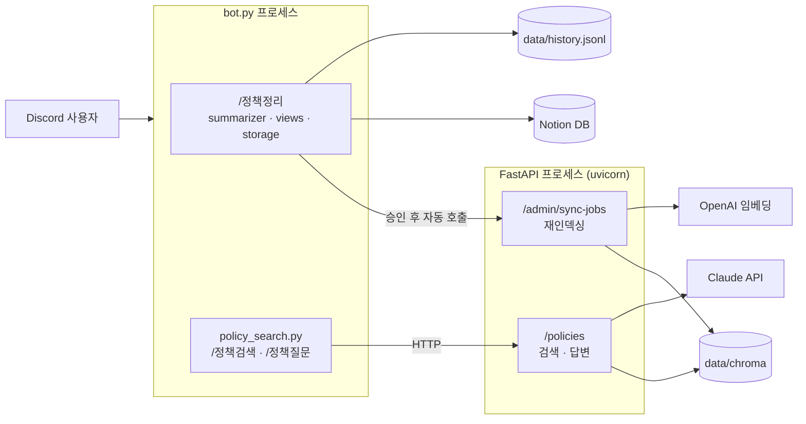

# policy-bot

Discord 스레드에서 흩어진 정책 결정을 정리해 Notion에 쌓고, 쌓인 결정을 RAG로 검색하고 질문하는 디스코드 봇.

- `/정책정리` — 스레드 논의를 Claude가 정책 결정으로 요약 → 요청자 승인 → Notion DB + 로컬 JSON 저장
- `/정책검색` — 저장된 결정을 의미 기반으로 검색 (LLM 호출 없음)
- `/정책질문` — 검색된 결정만 근거로 Claude가 답변 (최신 결론 · 히스토리 · 충돌 · 확인 필요 + 출처)

## 구조



봇과 API는 별도 프로세스이고 HTTP로만 통신한다. 봇은 RAG 로직을 갖지 않고, 검색 인덱스는 API 서버 프로세스만 갱신한다.

### RAG 흐름

| 단계 | 파일 | 하는 일 |
|---|---|---|
| 로드 | `app/rag/notion_loader.py` | Notion DB(또는 `history.jsonl`)의 결정을 텍스트 + 메타데이터로 변환 |
| 청킹 | `app/rag/chunker.py` | 800자 단위로 자르고 조각마다 `[정책] 주제 \| 영역 \| 상태` 헤더 부착 |
| 임베딩 | `app/rag/embedder.py` | OpenAI 또는 로컬(e5) 모델로 벡터화 |
| 저장 | `app/rag/store.py` | Chroma(`data/chroma`)에 저장. 바뀐 결정만 재처리 |
| 검색 | `app/rag/retriever.py` | 유사도 검색 + 영역/상태 필터 + 점수 하한선 + 결정당 1개 |
| 생성 | `app/rag/generator.py` | 검색 결과를 `<context>`로 붙여 Claude가 근거 기반 답변 |

## 폴더 구성

```
├── bot.py               # 디스코드 봇 진입점, /정책정리
├── summarizer.py        # 스레드 → 정책 결정 요약 (Claude)
├── prompts.py           # 요약 프롬프트 / 출력 스키마
├── views.py             # 승인·취소 버튼, 승인 후 재인덱싱 요청
├── storage.py           # 로컬 JSON + Notion 저장
├── notion_store.py      # Notion DB 스키마와 저장
├── setup_notion.py      # Notion DB 최초 생성 (1회)
├── policy_search.py     # /정책검색, /정책질문 → API 호출
├── config.py            # 봇 설정 (기능영역, 상태 목록)
├── app/
│   ├── config.py        # RAG/API 설정 (.env 공유)
│   ├── api/             # FastAPI: main, routers, schemas, deps
│   └── rag/             # 로더, 청킹, 임베딩, 저장소, 검색, 생성
├── scripts/ingest.py    # CLI 인덱싱 + 검색 확인
└── tests/               # API 키 없이 도는 테스트
```

## 시작하기

### 1. 디스코드 봇 만들기
1. https://discord.com/developers/applications → New Application
2. **Bot** 탭 → Reset Token → 토큰 복사
3. **Bot** 탭 → Privileged Gateway Intents → **Message Content Intent 켜기**
4. **OAuth2 → URL Generator**
   - Scopes: `bot`, `applications.commands`
   - Bot Permissions: View Channels, Read Message History, Send Messages, Send Messages in Threads, Embed Links
5. 생성된 URL로 테스트 서버에 초대
6. 디스코드 설정 → 고급 → 개발자 모드 → 서버 우클릭 → ID 복사 → `GUILD_ID`

### 2. Notion 연결 (선택)
1. https://app.notion.com/developers/connections 에서 connection 생성 → 토큰 복사
2. DB를 넣을 페이지 ··· → Add connections → 만든 connection 추가
3. `.env`에 `NOTION_TOKEN`, `NOTION_PARENT_PAGE_ID` 입력 후 `python setup_notion.py`

Notion을 설정하지 않으면 결정은 `data/history.jsonl`에만 저장되고, RAG도 이 파일을 읽는다.

### 3. 설치와 설정
```bash
python -m venv .venv && source .venv/bin/activate
pip install -r requirements.txt
cp .env.example .env
```

| 키 | 필수 | 설명 |
|---|---|---|
| `DISCORD_TOKEN` | ✅ | 봇 토큰 |
| `ANTHROPIC_API_KEY` | ✅ | 요약, `/정책질문` 답변 |
| `GUILD_ID` | 권장 | 지정하면 해당 서버에 커맨드 즉시 등록 |
| `CLAUDE_MODEL` | | 기본 `claude-sonnet-5-5` |
| `NOTION_TOKEN`, `NOTION_DATA_SOURCE_ID` | | Notion 저장/조회. `setup_notion.py`가 ID를 채움 |
| `EMBEDDING_BACKEND` | | `openai`(기본) 또는 `local` |
| `OPENAI_API_KEY` | openai일 때 | 임베딩용 |
| `RAG_SOURCE` | | `auto`(Notion 있으면 Notion) / `notion` / `jsonl` |
| `RAG_MIN_SCORE` | | 검색 점수 하한선, 기본 `0.3` |
| `ADMIN_TOKEN` | ✅ | `/admin/sync-jobs` 인증. 임의의 긴 문자열 |
| `POLICY_API_URL` | | 봇이 부를 API 주소, 기본 `http://localhost:8000` (Docker에서는 `http://api:8000`) |
| `API_KEY` | 외부 공개 시 | `/policies/*` 인증 키 |
| `RERANK_ENABLED` | | LLM 리랭킹 사용 (`RERANK_MODEL` 기본 `claude-haiku-5-5`) |
| `SUMMARY_MAX_TOKENS` | | 요약 응답 최대 토큰, 기본 8192 |

로컬 임베딩을 쓰려면 `pip install sentence-transformers` 후 `EMBEDDING_BACKEND=local`. 백엔드를 바꾸면 `python -m scripts.ingest --force`로 전체 재인덱싱한다.

### 4. 실행 (터미널 2개)
```bash
# 터미널 A — API 서버 (http://localhost:8000/docs)
uvicorn app.api.main:app --reload

# 터미널 B — 봇
python bot.py
```
로그에 `길드 ...에 커맨드 3개 등록`이 뜨면 준비 완료.

처음 한 번은 인덱스를 만들어야 한다. API 서버가 떠 있는 상태에서:
```bash
curl -X POST localhost:8000/admin/sync-jobs \
  -H "X-Admin-Token: $(grep ^ADMIN_TOKEN .env | cut -d= -f2)" \
  -H "Content-Type: application/json" -d '{}'
```
이후 `/정책정리`로 승인한 결정은 자동으로 인덱스에 반영된다.

## API

| Method | Path | 설명 |
|---|---|---|
| GET | `/policies/search?q=&k=&area=&status=` | 정책 검색 |
| POST | `/policies/answers` | RAG 답변 `{question, area?, status?, k?}` |
| POST | `/admin/sync-jobs` | 재인덱싱 작업 생성 → `202` + `Location` (`X-Admin-Token` 필요) |
| GET | `/admin/sync-jobs/{id}` | 작업 상태 |
| GET | `/admin/usage?days=7` | 기능별 토큰·비용·지연 집계 (`X-Admin-Token` 필요) |
| GET | `/health` | 헬스체크, 인덱싱된 청크 수 |

주요 상태 코드: `401` 토큰 오류 · `409` 동기화 진행 중 · `422` 입력 검증 실패 · `502` Claude 호출 실패 · `503` 답변 기능 미설정

## 측정
### 토큰 사용량
Claude/OpenAI를 부를 때마다 `data/usage.jsonl`에 한 줄씩 기록된다 (기능: `summarize` · `answer` · `embed_query` · `embed_index` · `judge`).
- `/정책질문` 답변 하단에 이번 답변의 토큰/비용/시간 표시
- `GET /admin/usage?days=7` 로 기능별 합계·평균
- 단가는 `.env`의 `PRICE_*` (USD/100만 토큰)

### 정확도
`eval/golden.jsonl`(질문 → 정답 결정 제목 · 필수 단어) 기준으로 평가. 형식은 `eval/golden.example.jsonl`, 자세한 내용은 `eval/README.md`.
```bash
python -m scripts.eval_rag --sweep          # 검색: Hit@k · MRR · 거절 정확도 + 하한선별 비교
python -m scripts.eval_rag --answers        # 답변: 핵심어 포함률 · 인용률 · 거절 정확도 + 1회당 비용
python -m scripts.eval_rag --rerank --answers   # 리랭킹 켠 상태로 같은 평가 (전후 비교)
```

### 측정 결과 (2026-10-19, 결정 83건 · 38문항)
| | 벡터 검색 | + LLM 리랭킹 |
|---|---|---|
| 검색 Top1 | 83% | 97~100% |
| 문서에 없는 질문 거절 (검색 단계) | 12.5% | 87.5% |
| 답변 핵심어 포함률 / 답변 단계 거절 | 100% / 100% | 100% / 100% |
| 질문당 총비용 | $0.0253 | $0.0206 |

## 리랭킹
벡터 검색 상위 10개를 작은 모델(Haiku)이 질문과 함께 읽고 0~3점으로 다시 채점한다. 2점 미만은 버리고, 남는 게 없으면 "관련 결정 없음"으로 거절한다.
점수는 도구 호출(tool use)로 받는다. 텍스트로 JSON을 요청했을 때는 모델이 설명을 붙여 출력 한도에서 잘렸다(38회 중 22회).
`.env`의 `RERANK_ENABLED=true`로 켠다.

## 초기 데이터 일괄 정리
지난 스레드를 한 번에 `/정책정리` 한다. Discord에는 읽기만 하므로 흔적이 남지 않는다.
```bash
python -m scripts.batch_summarize data/links.txt          # 요약 → data/batch/review-*.json (저장 안 함)
python -m scripts.batch_summarize --commit data/batch/review-*.json --approved-by 이름   # 검토 후 저장
```
날짜는 두 가지로 저장된다. **결정일**은 결정마다 근거 메시지 중 가장 늦은 메시지 시각이고, 검색·답변의 시간순 정렬 기준이다. **정리일**은 승인한 시각이다. 정리가 늦어져도 과거 결정이 '오늘'로 기록되지 않도록 둘을 나눴다.

## Docker 실행 (Mac 홈서버 / 클라우드 공통)
```bash
docker compose up -d --build        # api + bot
docker compose ps                   # api가 (healthy)인지
docker compose --profile tunnel up -d   # (선택) Cloudflare 임시 터널로 API 외부 공개. API_KEY 필수
```
봇은 Discord로 나가는 연결만 쓰므로 공유기 포트포워딩 없이 Mac에서 돌려도 팀원이 사용할 수 있다.
외부 공개 시 `/policies/*`는 `X-API-Key`가 필요하다(`.env`의 `API_KEY`). 클라우드 배포 절차는 `docs/DEPLOY.md`.

## 테스트
```bash
python -m pytest -q
```
가짜 임베더와 메모리 Chroma를 쓰기 때문에 API 키 없이 동작한다.

## 저장 위치 (git 제외)
- `data/decisions/<기능영역>/<시각>_<id>.json` — 결정 1건씩
- `data/history.jsonl` — 전체 히스토리 (append-only)
- `data/chroma/` — 검색 인덱스

## 트러블슈팅
| 증상 | 원인 |
|---|---|
| 커맨드가 안 보임 | `GUILD_ID` 확인, 디스코드 앱 새로고침 (Cmd/Ctrl+R) |
| 요약이 비어 있음 | Message Content Intent 꺼짐 |
| `Missing Access` | 봇이 그 채널/스레드를 볼 권한 없음 (비공개 스레드는 봇 추가) |
| 검색 시 "연결할 수 없어요" | 터미널 A의 uvicorn이 꺼져 있음 |
| 새 결정이 검색에 안 나옴 | 승인 직후 몇 초 대기. 계속 안 나오면 위 `curl`로 수동 동기화 |
| 엉뚱한 결과가 나옴 / 결과가 너무 없음 | `RAG_MIN_SCORE`를 올리거나 내리기 |
| `object_not_found` (Notion) | DB 페이지에 connection을 추가하지 않음 |
| `insufficient_quota` (OpenAI) | API 크레딧 없음 |

## 다음 단계
- Docker + docker-compose로 봇과 API를 한 번에 배포 (API는 내부망에만 노출)
- API를 외부에 공개하게 되면 Nginx 리버스 프록시 + HTTPS, `/admin` 외부 차단
- 동기화 작업 상태를 메모리 대신 영속 저장소로
