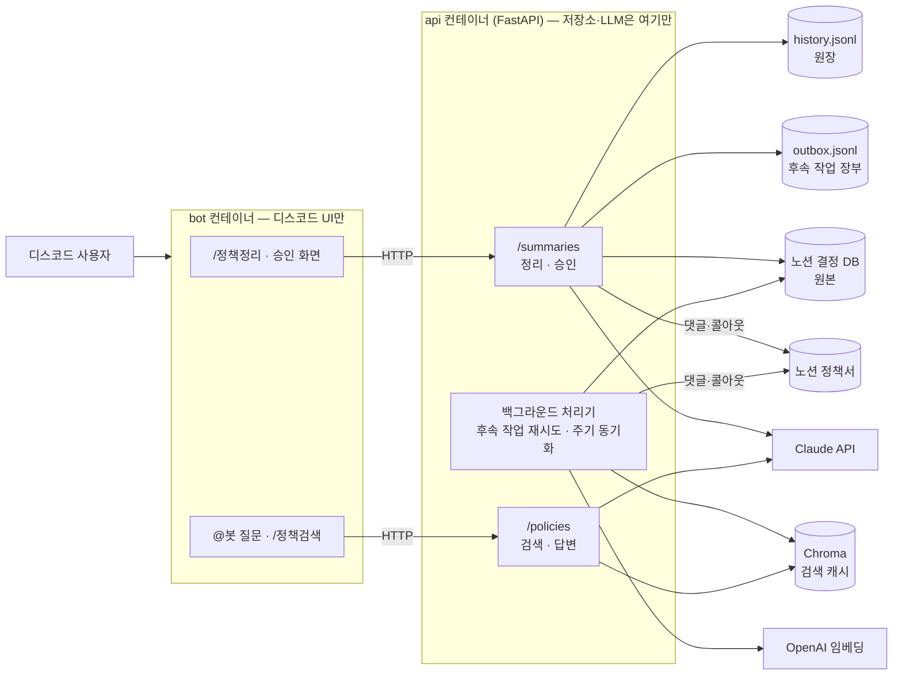
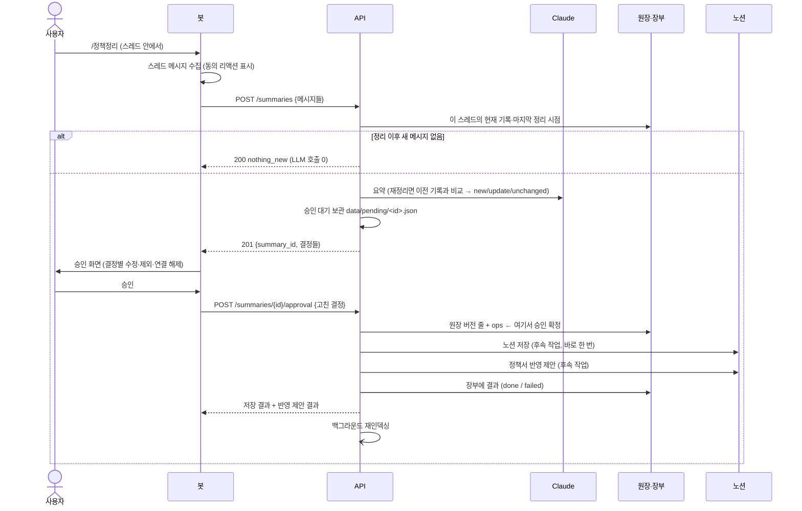
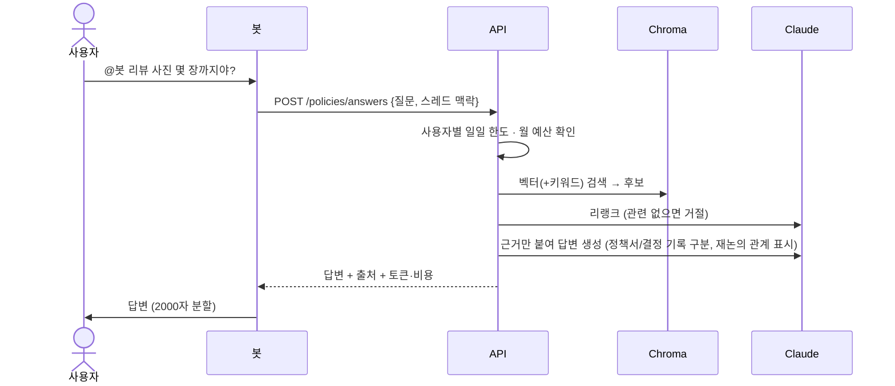

# policy-bot 엔지니어링 노트 — 전체 그림, 흐름, 신경 쓴 부분

> 디스코드 스레드에 흩어진 제품 정책 결정을 정리해 노션에 쌓고, 쌓인 결정을 근거로 질문에 답하는 봇.
> 작은 팀용 도구지만, 데이터가 여러 곳(디스코드·노션·로컬 파일·벡터 DB)에 걸쳐 있어서 **"어디가 원본이고, 실패하면 무엇이 남는가"**를 처음부터 정해 두고 만들었다.
> 설계 결정의 배경은 [`DIRECTION.md`](DIRECTION.md), 점검과 개선 과정은 [`ARCHITECTURE_REVIEW.md`](ARCHITECTURE_REVIEW.md), 진행 기록은 [`EXPERIMENTS.md`](EXPERIMENTS.md).
> (이 문서의 예시는 모두 가짜 데이터다.)

---

## 1. 무엇을 하나

| 기능 | 사용자가 하는 것 | 봇이 하는 것 |
|---|---|---|
| **정리** | 논의가 끝난 스레드에서 `/정책정리` | 대화를 결정 단위로 요약 → 승인 화면 → 승인하면 노션에 저장하고, 기준 정책서에 "반영 제안" 댓글을 단다 |
| **질문** | `@봇 리뷰 사진은 몇 장까지야?` | 노션 결정 기록 + 정책서를 검색해 근거(링크) 붙여 답한다. 근거가 없으면 거절 |
| **검색** | `/정책검색 북마크` | 답변 생성 없이 관련 결정 목록만 |

원칙 세 가지가 전체 설계를 끌고 간다.
1. **노션이 원본이다.** 봇은 노션 정책서 원문을 직접 고치지 않는다. 바꿔야 할 곳에 댓글·색 블록으로 "제안"만 하고, 반영은 PM이 한다.
2. **쓰기는 사람이 확인한 뒤에만.** 정리 결과는 승인 화면에서 사람이 고치고 승인해야 저장된다. 자유 질문(멘션)에서 봇이 "정리하라는 뜻인가"를 추측해 쓰지 않는다.
3. **비용을 기록하지 않는 LLM 호출은 없다.** 모든 호출이 사용량을 남기고 예산 한도를 거친다.

---

## 2. 전체 그림

컨테이너는 두 개, 이미지는 하나다(명령만 다름). 봇은 디스코드로 **나가는** 연결만 쓰므로 열린 포트가 없고, API는 서버 자기 자신(`127.0.0.1`)에만 열려 있다.

### 구성 요소

| 구성 | 위치 | 하는 일 |
|---|---|---|
| 봇 | `bot.py` · `views.py` · `mention.py` · `policy_search.py` | 스레드 메시지 수집, 승인 화면(결정별 수정·제외), 답변 표시. **LLM·노션·원장 코드를 import하지 않는다** (테스트로 고정) |
| 흐름 | `app/services/` | 요약·재정리 판정(`summarizer`), 승인 저장(`storage`), 정책서 반영 제안(`spec_reflect`), 승인 대기·멱등 승인(`approvals`), 후속 작업 실행(`followups`), 대조(`reconcile`) |
| 노션 | `app/notion/` | 클라이언트 생성 1곳(재시도·로그), 속성 스키마 1곳(쓰기·읽기 공용), 결정 기록 저장소(`DecisionRepository`) |
| 원장·장부 | `app/ledger.py` · `app/outbox.py` | 승인된 버전의 append-only 기록, 후속 작업 결과 |
| 검색 | `app/rag/` | 로더 → 청킹 → 임베딩 → Chroma → 벡터(+BM25) 검색 → LLM 리랭크 → 답변 생성 |
| LLM | `app/llm.py` | 모든 Claude 호출의 단일 통로: 예산 확인 → 호출 → 사용량 기록 → 오류 분류 |
| 운영 | `app/logging_setup.py` · `app/ops.py` · `app/worker.py` | 로그·request_id, 운영 알림·`/health`, 백그라운드 처리기 |
| 설정 | `app/config.py` | `.env`·환경변수를 읽는 유일한 곳 (`Settings`) |

---

## 3. 흐름

### 3-1. 정리 → 승인 → 저장

**재정리.** 같은 스레드를 다시 정리하면 결정마다 `new` / `update` / `unchanged`를 판정한다. 바뀐 결정만 이전 기록을 덮어쓰고(이전 버전은 노션 본문 '변경 이력'에), 이전이 최종결정인데 이번이 논의중이면 덮지 않고 "재논의" 기록으로 연결한다. **잘못 연결(유효한 기록이 덮어써짐)이 놓침(중복)보다 위험**하다고 보고, 애매하면 새 기록으로, 확정은 승인 화면의 사람에게 맡겼다.

### 3-2. 질문

### 3-3. 백그라운드 (API 안)

- 30초마다: 후속 작업 장부에서 다시 할 때가 된 것을 실행 (노션 저장 → 정책서 반영) → 노션 저장이 끝나면 재인덱싱
- 10분마다: 주기 재인덱싱. 내용 해시로 비교해서 바뀐 문서만 다시 임베딩 (안 바뀌면 비용 0). 승인 외의 변경(노션에서 사람이 고침, 정책서 수정)도 이 안에 검색에 반영된다

---

## 4. 신경 쓴 부분

### 4-1. 통로를 하나로 — 봇은 UI, 쓰기는 API만

처음에는 읽기(검색·답변)만 API에 있고, **쓰기(요약 LLM, 노션 저장, 정책서 반영)는 봇 프로세스 안**에 있었다. 그러다 보니 같은 일을 하는 코드가 두 프로세스에 흩어졌다. 노션 클라이언트가 3개, 설정을 읽는 방식이 4가지, 사용량 파일을 쓰는 프로세스가 2개였다. 재시도·로그·한도를 어디에 넣어야 하는지도 매번 애매했다.

[Boo](https://vvip-blog.pages.dev/blog/boo)의 "봇은 DB를 직접 건드리지 않고 manager API를 통한다"는 구조를 참고해서, **외부 저장소에 닿는 코드는 API 한 프로세스에만** 두기로 했다.
- 봇은 메시지를 모아 HTTP로 보내고 화면만 그린다. 봇이 `anthropic`·`notion_client`·`chromadb`를 import하지 않는지 **테스트가 확인**하고, 봇이 보내는 본문이 API 스키마를 통과하는지도 계약 테스트로 확인한다.
- 그 결과 재시도·멱등성·로그·한도를 **한 번만** 구현하면 된다.
- 대가: API가 죽으면 `/정책정리`도 안 된다. 검색이 이미 API에 의존하고 있어서 받아들였다.
- Boo처럼 별도 언어로 서버를 짜거나 Postgres·Redis를 두지는 않았다. 결정 수백 건 규모에선 비용만 늘어난다.

### 4-2. 저장소마다 역할을 하나씩 — 왜 노션과 벡터 DB를 따로 두나

| 저장소 | 역할 | 지워지면 |
|---|---|---|
| 노션 결정 DB | **원본.** 사람이 읽고 고치고 댓글 다는 곳 | 복구 대상 |
| `history.jsonl` | **원장.** 승인된 버전의 append-only 기록 (변경 이력·재정리 기준·감사) | 복구 대상 |
| `outbox.jsonl` | 후속 작업 결과 | 괜찮다 — 작업이 멱등이라 "아직 안 함"으로 보고 한 번 더 할 뿐 |
| Chroma | **검색 캐시.** 노션에서 언제든 다시 만든다 | 괜찮다 — 재인덱싱 |

노션은 사람이 쓰기 좋지만 의미 검색을 못 하고 API가 느리다(초당 약 3회). Chroma는 빠르지만 사람이 볼 수 없다. 둘을 따로 두는 대신 **"Chroma는 지워도 되는 캐시"**라는 규칙을 지켰다. Chroma에 쓰는 코드는 인덱싱 하나뿐이다.

### 4-3. 실패해도 잃지 않게 — 커밋 지점 · 후속 작업 · 멱등성

로컬 파일과 노션은 하나의 트랜잭션으로 묶을 수 없다. 노션 자체에도 트랜잭션이 없다(페이지 하나 덮어쓰기도 API 호출 여러 번). 그래서 목표를 "원자성"에서 이렇게 바꿨다.

> **어디까지 됐는지 반드시 남기고, 남은 일은 다시 해도 안전하고, 어긋난 것은 결국 찾아낸다.**

1. **커밋 지점 = 원장 한 줄.** 승인은 원장에 버전 줄이 써지는 순간 확정된다. 그 줄에 해야 할 일(`ops: [notion_upsert, spec_reflect]`)을 같이 쓴다. 결정과 할 일이 한 줄이라 둘이 어긋날 수 없다 (아웃박스 패턴을 파일로).
2. **후속 작업.** 노션 저장·정책서 반영은 승인 직후 한 번 실행하고, 결과를 장부에 남긴다. 실패하면 처리기가 1·2·4…30분 간격으로 다시 하고, 6번 실패하거나 권한·형식 오류(400·401·403·404)면 포기(dead)하고 운영 채널에 알린다. 대기 목록은 각 기록의 **현재 버전만** 본다 (v2가 생기면 v1의 노션 저장은 의미가 없다).
3. **멱등 쓰기.** 다시 실행해도 결과가 같게:
   - 페이지를 만들기 전에 기록ID로 먼저 찾는다 → "생성은 됐는데 응답만 타임아웃"이어도 중복 페이지가 없다.
   - 덮어쓰기 순서는 *지금 블록 ID 기록 → 새 블록 추가 → 기록한 블록 삭제 → 속성 마지막*. 본문이 비는 순간이 없고, 중간에 실패해 다시 해도 마지막 시도의 블록만 남는다.
   - 속성을 마지막에 쓰므로 "정리일이 이 버전의 승인 시각이고 내용이 같으면" 이미 다 쓴 것이다.
4. **대조.** 원장과 노션을 비교해 노션에 없음·사람이 지움·옛 버전·사람이 고침·원장에 없는 페이지를 **보고만** 한다. 사람이 지운 페이지를 "없으니 다시 만들기"로 되살리면 의도를 거스르기 때문이다.

**함정 하나 — 노션 시각은 분 단위다.** 승인 시각 `13:10:05`가 노션에는 `13:10:00`으로 저장된다. 처음엔 완료 표시를 초까지 비교해서 항상 "아직 안 씀"으로 보였다(중복은 기록ID 조회가 막았지만, 재시도할 때마다 다시 썼다). 실제 노션과 대조했을 때 수백 건이 "옛 버전"으로 나와서 알았고, 분 단위 + 내용 비교로 고쳤다. 예전에 재인덱싱 건너뛰기를 노션 `last_edited`(역시 분 단위)로 했다가 같은 분 안의 수정을 놓친 적이 있어서, 그때부터 인덱싱은 **내용 해시**로 비교하고 있었다. 같은 교훈을 두 번 배운 셈이다.

외부 라이브러리가 이미 해 주는 것도 확인했다. notion-client 3.1은 429를 모든 요청에서, 5xx를 GET·DELETE에서만 재시도한다(쓰기를 다시 보내면 중복이 생길 수 있어서). 그래서 재시도를 직접 만들지 않고 설정만 한 곳에서 명시했다.

### 4-4. 같은 요청이 두 번 와도 한 번만

정리 결과는 API가 `data/pending/<id>.json`에 보관하고, 봇은 승인할 때 `summary_id`와 사람이 고친 결정만 보낸다. 네트워크 재시도나 버튼 연타로 같은 승인이 두 번 오면, 두 번째는 저장하지 않고 첫 결과를 돌려준다(`replayed: true`). 결정은 이제 HTTP로 들어오는 외부 입력이라, `id`·`version`·`ops`처럼 저장 단계가 정하는 값은 입력으로 덮어쓰지 못하게 막았다. 기능영역·상태가 노션 선택지에 없으면 저장 전에 422로 거절한다.

### 4-5. 비용은 한 통로에서 센다

모든 Claude 호출(요약·정책서 매칭·리랭크·답변·평가 채점)은 `app/llm.py`를 지난다. 그 안에서 월 예산 확인 → 호출 → 사용량 기록(기능·모델·토큰·비용·사용자·request_id) → 실패 분류가 자동으로 일어난다. 정리하면서 보니 **요약은 그동안 예산 확인을 거치지 않고 있었다**. 경로가 여러 개면 원칙을 사람이 지켜야 하고, 하나면 코드가 지킨다. `messages.create`를 직접 부르는 코드가 다시 생기면 테스트가 실패한다.

실패는 사용자에게 보여 줄 수 있는 말로 바꾼다. API 응답 코드도 의미를 나눴다. 잠시 뒤 나아질 수 있는 실패(혼잡·레이트리밋·타임아웃)는 503, 설정 문제(키·지출 한도·요청 형식)는 502, 예산 초과는 429. 지출 한도·키 문제는 운영 채널에도 알린다(1시간에 한 번).

사용량은 별도 서비스로 빼지 않았다. Boo도 토큰 사용량을 따로 떼지 않고 저장 서비스의 한 영역으로 뒀다. 한도 확인이 매 답변 전에 사용량을 읽기 때문에, 서비스를 나누면 "사용량 서비스가 죽으면 답변을 막나 보내나"를 정해야 한다. 같은 프로세스면 그 질문이 없다.

### 4-6. 알 수 있게 — request_id, JSON 로그, health

- **request_id**: 봇이 요청을 받는 지점마다 ID를 만든다(멘션 `m-`, 정리 `s-`, 검색 `q-`). 승인 버튼은 정리 때 ID를 이어받고, `X-Request-ID`로 API까지 간다. API 로그·응답 헤더·사용량 기록에 같은 ID가 남아, `grep s-1a2b3c4d` 한 번으로 "이 승인이 어디서 실패했나"를 따라간다. 밖에서 온 헤더 값은 형식을 검사한다(로그 위조 방지).
- **로그**: 설정 한 곳, 서버에서는 한 줄 = JSON 하나. 정리하다 보니 API 쪽엔 로그 핸들러가 없어서 INFO 로그가 그동안 버려지고 있었다.
- **`/health`**: 항상 200을 돌려주고, 내용에 `ok | degraded`와 이유를 담는다. Docker healthcheck는 "재시작하면 나아지나"를 판단하는데, 설정 오류나 노션 장애는 재시작해도 안 나아진다. 그래서 둘을 분리했다. degraded 이유에는 설정 문제, 동기화 연속 실패, 포기한 후속 작업, 30분 넘게 밀린 대기, 원장의 깨진 줄이 있다.
- **운영 알림**: 봇 시작(호스트 이름 포함 — 같은 토큰으로 두 곳에서 띄우면 바로 보인다), 동기화 3회 연속 실패, 후속 작업 포기, 대량 삭제 차단, 예산 80%.

### 4-7. 지우기 전에 한 번 더 — 대량 삭제 안전장치

노션 권한이 바뀌거나 DB ID가 틀리면 로더가 "문서 0개"를 돌려준다. 그대로 "노션에 없는 문서는 인덱스에서 지우기"를 하면 검색 인덱스가 통째로 사라진다. 이번에 읽은 문서가 기존의 절반 미만이면 삭제를 멈추고 알린다. 정말 지워야 할 때만 `allow_mass_delete`를 쓴다.

### 4-8. 설정은 한 곳, 문제는 시작할 때

`.env`를 읽는 곳이 하나(`Settings`)다. 봇 코드의 `from config import X`는 그 값을 같은 이름으로 다시 내보내는 얇은 층이라, 통합하면서 기존 코드를 거의 고치지 않았다. 시작할 때 역할별로 빠진 값을 한 번에 알려 준다(봇: 디스코드 토큰·API 주소, API: Claude 키·임베딩 키·노션 짝). 테스트는 로컬 `.env`를 읽지 않는다. 개발자 `.env` 값(예: `RAG_SOURCE=notion`) 때문에 실패하던 테스트가 실제로 있었다.

### 4-9. 숫자로 비교한다

새 구성요소는 효과를 숫자로 보인 뒤에만 기본값으로 켠다.
- 골든셋(유형별: 기본·근거 없음·정확 문자열·정책서·함정·이력·충돌)으로 검색·답변을 잰다. 예) 정책서 인덱싱 → 정책서 질문 0/5 → 5/5. 하이브리드 검색은 리랭크 없이는 모든 지표가 올랐지만 리랭크와 함께면 거절이 약해져서 기본 꺼짐으로 뒀다.
- 리팩터링 단계마다 테스트 수가 유지되는지 확인했다(133 + 실패 1 → 223 통과). 설정 통합 때는 옛 설정과 새 설정의 값 23개가 같은지 실제 `.env`로 비교했다.

---

## 5. 장애가 나면 — 무엇이 남고 어떻게 돌아오나

| 상황 | 남는 것 | 돌아오는 길 |
|---|---|---|
| 노션 저장 실패 (5xx·타임아웃) | 원장 줄 + 장부 failed | 처리기가 백오프로 재시도, 끝나면 재인덱싱 |
| 노션 생성은 됐는데 응답 못 받음 | 노션 페이지 + 장부 failed | 재시도가 기록ID로 찾아 "이미 있음" → 중복 없음 |
| 덮어쓰기 중간 실패 | 본문 = 옛 블록 일부 + 새 블록 (비지 않음) | 재시도 → 마지막 시도 블록만 남음, 속성 마지막 |
| 권한·형식 오류 (400·401·403·404) | 장부 dead | 운영 알림 → 사람이 고치고 `scripts.outbox retry --include-dead` |
| 승인 처리 중 API 재시작 | 원장 줄의 ops, 승인 대기 파일 | 처리기가 이어서 실행 |
| 같은 승인 두 번 | 첫 결과 | 저장 없이 첫 결과 반환 |
| 재인덱싱 누락·실패 | 노션은 최신 | 10분 주기 재인덱싱, 3회 연속 실패 시 알림 |
| 노션이 비정상적으로 적게 읽힘 | 기존 인덱스 | 삭제 중단 + 알림 |
| Claude 지출 한도·키 문제 | 사용자에게 안내 문구 | 운영 알림 (1시간 1회) |
| 사람이 노션에서 페이지 삭제·수정 | 원장 | 대조가 보고 (되살리지 않음) |

---

## 6. 배포

- **단일 VM + Docker Compose**, 이미지 1개에 컨테이너 2개(api·bot). 인바운드는 SSH만 열고, API는 `127.0.0.1`에만 바인딩한다.
- 같은 서버의 다른 서비스를 지키는 상한: `mem_limit`·`cpus`(api 1GB/1 CPU, bot 512MB/0.5 CPU — 실측 전 추정값), 로그 회전(컨테이너당 10MB × 3).
- 처리기는 API 프로세스 안에 하나(uvicorn worker 1개 전제). worker를 늘리거나 동기화가 답변 지연에 영향을 주면 같은 이미지로 `worker` 컨테이너를 분리한다. 그 전까지는 단순한 쪽을 유지한다.
- 운영 명령: `/health`, `scripts.outbox list|retry`, `scripts.reconcile`, `docker compose logs api bot | grep <request_id>` ([`DEPLOY.md`](DEPLOY.md)).

---

## 7. 아직 남은 것

- **노션 직접 수정을 언제 원장으로 가져올지** — 결정: 노션에서 고친 값이 현재 기록이 된다. 남은 질문: 봇이 그 기록을 건드리기 직전에만 가져올지, 주기적으로 전부 가져올지 ([`ARCHITECTURE_REVIEW.md`](ARCHITECTURE_REVIEW.md) 3-6).
- **아직 정리 안 된 디스코드 논의도 답변에 쓰기** — 최근 14일 + 노션에 없는 스레드만 키워드로 조회해 "[미정리 논의 있음]"과 [정책 정리하기] 버튼을 붙인다 (EXPERIMENTS 2단계). 이렇게 하면 비용이 쌓인 대화량이 아니라 정리 안 된 양에만 비례한다.
- 봇 컨테이너에서 노션·Claude 키를 실제로 빼려면 env 파일을 나눠야 한다 (지금은 같은 `.env`를 받지만 쓰지 않는다).
- 규모가 커지면 원장·장부·사용량을 SQLite 하나로 옮긴다. 그때 원장 줄과 후속 작업을 진짜 트랜잭션으로 묶는다(cosmicpython의 Unit of Work). Repository 계층을 먼저 만들어 둬서, 바꾸는 건 구현 클래스 하나다.

---

### 배운 것 한 줄씩

- 통로가 여러 개면 원칙은 사람이 지키고, 하나면 코드가 지킨다.
- 원자성을 못 가지면 "어디까지 됐는지 남기기 + 다시 해도 안전하게 + 결국 찾아내기"로 바꾼다.
- 외부 서비스의 시각·정밀도는 가정하지 말고 실제로 찍어 본다 (노션은 분 단위).
- 자동 복구는 "되돌릴 수 있는 것"까지만. 지우거나 되살리는 건 사람에게 보고한다.
- 라이브러리가 이미 해 주는 것(재시도)은 다시 만들기 전에 소스를 읽어 본다.
